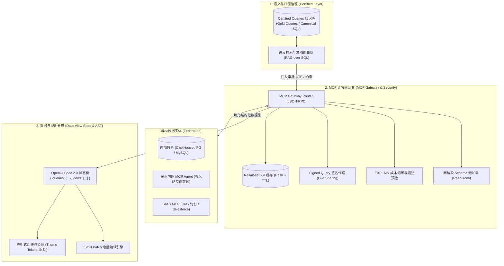
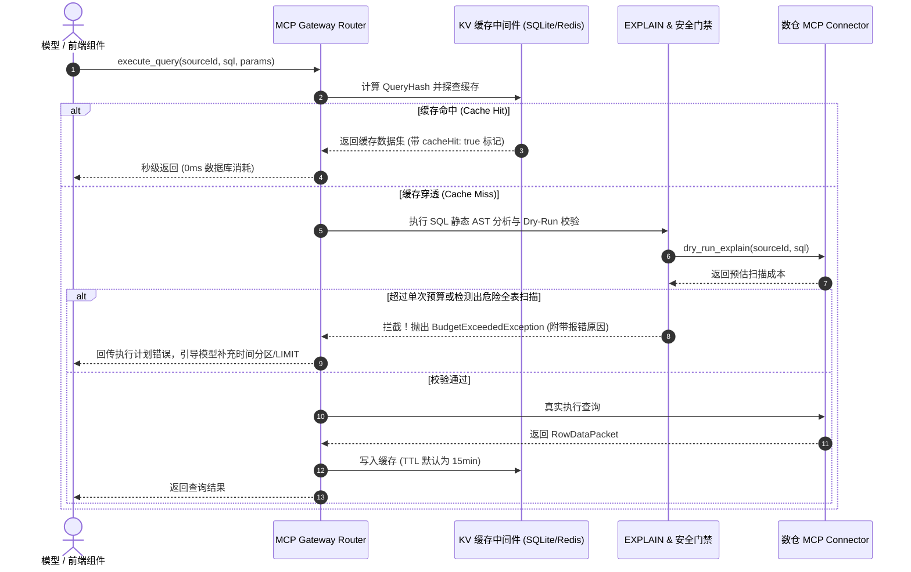
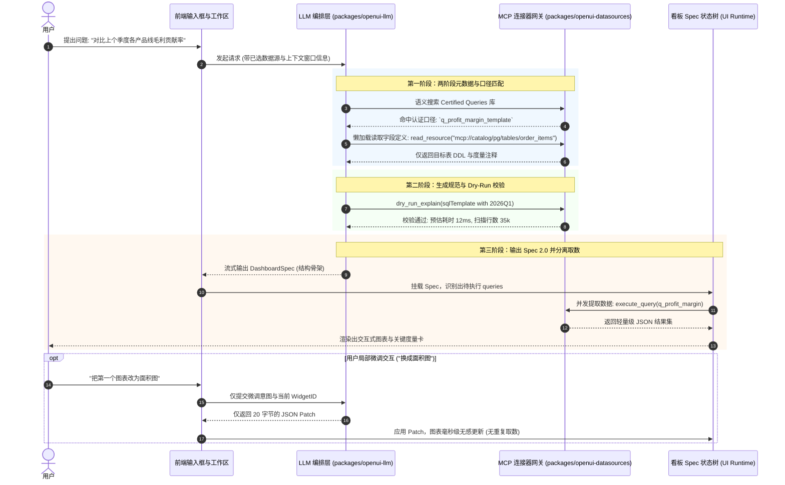
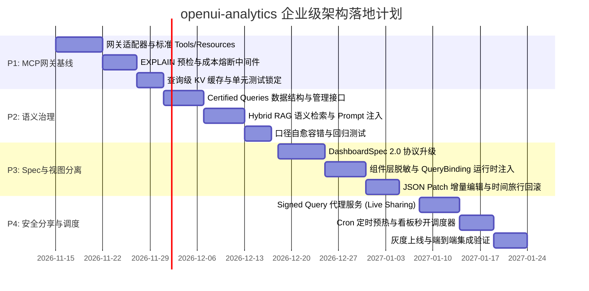

# openui-analytics 企业级架构演进实施方案

## 基于 MCP 连接器网关、Certified Queries 口径治理与 Data-View 分离

**文档版本**：v1.0.0 (RFC)  
**涉及模块**：`packages/openui-datasources`, `packages/openui-llm`, `packages/openui-components`, `src/app/api`  
**核心目标**：将 `openui-analytics` 从“对话式看板原型”重构升级为具备“确定性口径、零网络暴露数据联邦、声明式增量编辑”的企业级 AI 原生数据分析平台。

---

## 1. 架构愿景与三位一体蓝图

本方案以 **“确定性工程管线兜底，概率性大模型决策”** 为最高原则，通过三个互为支撑的核心子系统构建企业级数据基座：



---

## 2. 核心子系统详细设计

### 2.1 子系统一：基于 MCP 的连接器网关（MCP Connector Gateway）

#### 2.1.1 协议规范与职责分工

网关层部署在服务端 `packages/openui-datasources/src/gateway/`，对外向上暴露统一的标准 MCP 接口，向下适配各类异构存储：

- **Tools**：
  - `execute_query(sourceId, sql, params, options)`：经安全中间件拦截的 SQL 执行；
  - `dry_run_explain(sourceId, sql)`：调用数仓 `EXPLAIN` 获取预算与执行计划；
- **Resources**：
  - `mcp://catalog/overview`：返回当前启用的数据源列表及高层业务域描述（不含细部字段）；
  - `mcp://catalog/{sourceId}/tables/{tableName}`：**两阶段懒加载**，仅当模型需要时拉取指定表的详细 DDL、字段类型与前 3 条样本值。
- **Prompts**：
  - `mcp://prompts/certified_query/{queryId}`：暴露已经过业务方审计的标准口径模版。

#### 2.1.2 核心数据结构定义

```typescript
// packages/openui-datasources/src/gateway/types.ts

/** 认证查询定义（语义层核心元数据） */
export interface CertifiedQuery {
  id: string;
  sourceId: string;
  title: string;
  description: string;
  /** 业务口径声明，如：“净营收 = 交易流水 - 退款金额 - 渠道优惠补贴” */
  businessMetricFormula?: string;
  /** 标准 SQL 模版（支持命名参数与 CTE 形式） */
  sqlTemplate: string;
  allowedParams: Array<{
    name: string;
    type: "string" | "number" | "date" | "array";
    defaultValue?: unknown;
    description: string;
  }>;
  /** 适用场景标签（用于语义路由召回） */
  tags: string[];
  /** 维护者与审批状态 */
  certifiedBy: string;
  certifiedAt: number;
}

/** 结果集缓存元数据 */
export interface QueryCacheKey {
  sourceId: string;
  sqlHash: string; // sha256(normalize(sql))
  paramsHash: string;
}

/** EXPLAIN 成本分析报告 */
export interface ExplainCostReport {
  isValid: boolean;
  estimatedRows: number;
  estimatedBytes?: number;
  syntaxError?: string;
  isFullTableScan: boolean;
  exceedsBudget: boolean;
  costWarning?: string;
}

/** Signed Query 凭证代理（安全分享 Token 负载） */
export interface SignedQueryPayload {
  dashboardId: string;
  sourceId: string;
  sqlHash: string;
  paramConstraints: Record<
    string,
    { min?: string | number; max?: string | number; enum?: unknown[] }
  >;
  creatorId: string;
  exp: number; // 过期时间戳
}
```

#### 2.1.3 网关执行管道与中间件设计



---

### 2.2 子系统二：语义治理与 Certified Queries 机制

#### 2.2.1 解决痛点：口径幻觉与即兴发散

大模型直接写 SQL 时，经常由于表结构注释模糊，发生以下问题：

- 漏加 `is_deleted = 0` 或 `status = 'COMPLETED'`；
- 误用 `COUNT(user_id)` 替代 `COUNT(DISTINCT user_id)`；
- 财务指标将退款或优惠券算错方向。

#### 2.2.2 运作机制

1. **语义存储**：将企业沉淀的标准指标（如 CAC、LTV、MAU、净营收）整理为 `CertifiedQuery` 记录存入系统（支持配置导入与数据团队 UI 录入）。
2. **两阶段检索召回（Hybrid RAG over SQL）**：
   - 当用户输入自然语言问题后，编排层首先对 `CertifiedQuery.title + description + tags` 做向量相似度与 BM25 混合搜索；
   - **高置信度召回（Score > 0.85）**：直接向模型 Prompt 强约束：“已命中经过企业认证的权威口径模版【{title}】，严禁从零编写新 SQL，必须基于模版【{sqlTemplate}】扩展参数或进行外层二次聚合”；
   - **低置信度召回（0.6 ~ 0.85）**：作为推荐参考示例（Few-Shot）供给模型；
   - **未召回（< 0.6）**：回退至自由探索模式（此时必须强制受网关的 EXPLAIN 门禁约束）。

---

### 2.3 子系统三：数据与视图分离（Data-View Spec 2.0）

#### 2.3.1 协议重构对比

- **现有形态（1.0 内联数据）**：

  ```tsx
  <ComboChart
    title="2026年Q1各渠道获客成本与ROI走势"
    data={[
      {"channel": "搜索推广", "cac": 128, "roi": 3.4},
      {"channel": "信息流", "cac": 210, "roi": 2.1},
      ...成百上千行静态数据
    ]}
    series={[...]}
  />
  ```

  _弊端_：微调样式需要重跑整个大模型输出流，重新抄写成百上千行数据，造成 Token 爆炸、延迟巨大且易丢数据。

- **全新形态（2.0 Data-View Separation Spec）**：
  看板由统一的 JSON 结构树描述，支持直接序列化与精准 Patch：

```typescript
// packages/openui-components/src/spec/types.ts

export interface DashboardSpec {
  version: "2.0";
  metadata: {
    id: string;
    title: string;
    description?: string;
    themeTokens?: Record<string, string>; // 企业品牌定制设计变量覆写
  };

  /** 1. 数据查询管道定义 (Data Pipelines) */
  queries: Record<
    string,
    {
      sourceId: string;
      certifiedQueryId?: string; // 若绑定认证口径
      sql: string;
      params?: Record<string, unknown>;
      refreshInterval?: number; // 秒，用于实时轮询预热
      cacheTtl?: number;
    }
  >;

  /** 2. 栅格布局容器 (Layout Grid) */
  layout: {
    columns: number; // 默认 12 栅格
    gap: number;
    rows: Array<{
      id: string;
      widgets: Array<{
        id: string;
        colSpan: number; // 占用列数
        rowSpan?: number;
      }>;
    }>;
  };

  /** 3. 视图组件声明 (View Components) */
  widgets: Record<
    string,
    {
      type:
        | "MetricCard"
        | "AnalyticsChart"
        | "ComboChart"
        | "FunnelChart"
        | "DataTable";
      title: string;
      description?: string;
      /** 核心解耦点：图表仅指向查询 ID，不内嵌任何数据数组 */
      queryBinding: {
        queryId: string;
        dimensionField: string; // X 轴字段映射
        metricFields: string[]; // Y 轴度量字段映射
        filterConditions?: Record<string, unknown>;
      };
      chartConfig: Record<string, unknown>; // 颜色、轴线、图例配置
    }
  >;
}
```

#### 2.3.2 JSON Patch 增量编辑闭环

当用户在对话框说：“把中间图表改成折线图，颜色改用成功绿”时，模型输出标准的 RFC 6902 JSON Patch：

```json
[
  {
    "op": "replace",
    "path": "/widgets/w_trend/type",
    "value": "AnalyticsChart"
  },
  {
    "op": "replace",
    "path": "/widgets/w_trend/chartConfig/type",
    "value": "line"
  }
]
```

前端只需要在内存中通过 `immer` 或 `fast-json-patch` 执行该 Patch，组件立刻局部重渲，**零网络请求、零数据重传、响应延迟低于 200ms**。

---

## 3. 业务主流程时序设计

以下为用户从“输入自然语言提问”到“看板渲染与交互下钻”的端到端执行流：



---

## 4. 实施里程碑路线图（分阶段演进）

为确保系统平稳升级且每个版本均可稳定发布交付，方案规划为 4 个清晰迭代阶段：



### 阶段一：MCP 连接器网关基石与执行管线建设（P1，2 周）

- **目标**：实现统一的数据源代理层，消除单点 SQL 击穿数据库风险。
- **交付物**：
  1. `packages/openui-datasources/src/gateway/` 基础框架：实现基于 JSON-RPC 的统一网关；
  2. 实现 `dry_run_explain` 拦截器：针对 PostgreSQL / ClickHouse / MySQL 落地不同的执行计划探查器；
  3. 实现本地内存/SQLite 查询结果集缓存，基于 `SQL_Hash + Params` 缓存 15 分钟结果。
- **验收门禁**：高并发调用或全表扫描提问时，网关自动熔断拦截；重复提问在 5ms 内命中缓存返回。

### 阶段二：Certified Queries 语义资产与口径治理（P2，2 周）

- **目标**：杜绝核心业务指标的幻觉与口径漂移。
- **交付物**：
  1. 数据源配置页新增「认证指标与查询」Tab，支持录入/导入标准 SQL CTE 模版；
  2. 编排层增加前置语义检索路由：命中 Certified Query 时自动将其绑定到模型上下文；
  3. 执行失败时错误日志回灌模型，触发自愈重试闭环。
- **验收门禁**：针对预设的 20 个高频业务问题（如 MAU、净营收、ROI），系统 100% 命中认证口径，生成结果与数据团队基准差值为零。

### 阶段三：Data-View 分离与声明式状态机升级（P3，2.5 周）

- **目标**：彻底将海量静态数据从 UI 代码剥离，实现图表秒级增量微调。
- **交付物**：
  1. 发布 `packages/openui-components` 的 `DashboardSpec 2.0` 标准；
  2. 改造组件库（`ComboChart`, `AnalyticsChart` 等）：支持 `queryBinding` 运行时数据泵驱动；
  3. 实现客户端 JSON Patch 解析器：模型只需输出差量变更，前端自动完成局部合并与历史堆栈入栈。
- **验收门禁**：用户提出“修改图表类型或主色”需求时，流式 Token 生成消耗下降 90% 以上，响应时间从数秒下降到 300ms 以内。

### 阶段四：Live Sharing 签名凭证代理与预热调度（P4，2 周）

- **目标**：提供企业级安全免密分享与零等待预热体验。
- **交付物**：
  1. 看板分享服务：基于 HMAC 生成包含 Query 白名单的 Signed Query Token；
  2. 访客只读网关代理：免数仓登录账号，仅放行被签署的查询模板与受控参数范围；
  3. Cron 调度 Worker：支持为特定看板设置晨间定时预热执行并刷入缓存。
- **验收门禁**：在无数据库权限的无痕浏览器中打开分享链接，看板可以正常刷新与切换时间过滤，但无法发起白名单外的任意 SQL。

---

## 5. 质量防护与设计系统（Design System）约束

在实施整个方案期间，严格恪守项目现有质量标准与规范（参考 [AGENTS.md](file:///Users/zhangbei/code/openui-analytics/AGENTS.md)）：

1. **唯一颜色事实来源**：
   - 所有新建与改造的组件（包括数据源网关弹窗、指标认证列表、状态标签）**一律严格使用 `src/app/globals.css` 中声明的语义 Token**（如 `bg-card`, `text-info-fg`, `border-border`, `bg-surface-sunken` 等），严禁引入硬编码颜色或 Tailwind 调色板类。
2. **数据源零硬编码**：
   - 网关层与语义层中不得出现特定公司/特定业务产品的名称硬编码，所有认证查询与源连接均由配置文件或动态注册表驱动。
3. **向前兼容与优雅降级**：
   - 现有的 OpenUI 1.0 DSL 代码（内嵌静态数据）在重构过渡期内保持兼容解析；若数据源未实现 `EXPLAIN` 接口，自动降级为安全模式并提示用户。
4. **测试守护要求**：
   - 每一个新中间件与核心函数（如 Hash 计算、Patch 应用、签名验签）均须在同目录下编写完整的 `*.test.ts` 单元测试，门禁全量通过方可合入。
